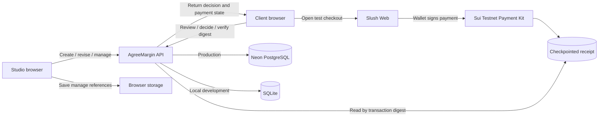
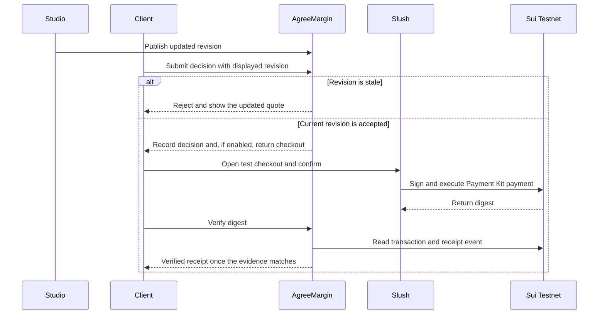

<p align="center">
  
</p>

# AgreeMargin

Agree on extra client work before it starts. AgreeMargin gives freelancers and small studios one review link for the scope, extra fee, and timeline. The client records a decision and both sides can reopen the same receipt.

[](https://agreemargin.vercel.app/)
[](#local-development)
[](#deployment)
[](#sui-testnet-verification)

[Open AgreeMargin](https://agreemargin.vercel.app/) · [User guide](https://agreemargin.vercel.app/docs) · [FAQ](https://agreemargin.vercel.app/faq)

## The problem

A client asks for one more deliverable in chat. The scope changes, but the additional fee and extra days are agreed in different messages or left unstated. By the time the invoice arrives, it can be hard to tell what the client approved.

AgreeMargin puts the proposed change and the decision together. It also supports optional test USDC checkout for studios evaluating payment on Sui.

## How it works

1. **Quote the change.** Enter the original scope, extra work, fee, and additional days. Offer a swap if it makes sense.
2. **Share the review link.** The client can keep the original scope, accept a swap, or approve the addition. Save the private manage link to revise or manage the request.
3. **Record the decision.** The server checks that the client is approving the current revision and locks the accepted terms. Both sides can use their links to print the receipt.
4. **Verify test payment if enabled.** After approval, the client opens Slush on Sui Testnet. Either party can submit the transaction digest for verification.

The browser’s **My requests** ledger shows saved requests, pending fees by currency, and estimated margin when a private delivery cost was entered. An approval records intent. A verified Testnet transfer records settlement with test assets.

## Architecture



The same request logic serves the local Node server and the Vercel function. The client uses vanilla JavaScript, shared CSS, and self-hosted DM Sans. Production uses Vercel and Neon PostgreSQL.



## Sui Testnet verification

The optional checkout uses the published Payment Kit registry. AgreeMargin hashes canonical revision terms and a random salt with SHA-256. The first 36 hexadecimal characters become the Payment Kit nonce. The verification step checks the transaction signer, expected registry, asset, amount, recipient, nonce, and successful execution in a checkpoint. A repeated submission of the same verified digest returns the existing result.

The downloadable revision record includes the canonical terms and salt so someone with that record can recreate the commitment. Keep the export private if it contains client terms.

| Verification run | Evidence |
|---|---|
| Sui SDK and Payment Kit | Revision 1 was rejected after revision 2 was published. The live app verified **0.10 test USDC** for revision 2 at checkpoint `410206607`. [Transaction](https://suiscan.xyz/testnet/tx/C5Lq7Tn15oxbsS4zroHQWx1cSXaQARikoqoBTdi5RsMV) |
| Slush Web end to end | The client paid **0.05 test USDC** using AgreeMargin’s checkout link. AgreeMargin verified revision 1 at checkpoint `410971176` and returned the same receipt on a fresh read. [Transaction](https://suiscan.xyz/testnet/tx/8aaRqLgQWav3EcHQrprnt76cWpKtyBNKi4fpS9Csf8h7) |

## Local development

Use **Node.js 24.x** and npm.

```sh
npm ci
npm run build
npm test
npm start
```

Open `http://127.0.0.1:4547`. The local server uses `.local/agreemargin.sqlite`. Set `AGREEMARGIN_PORT` to use another port. Run `npm run build` again after editing source files. The smoke suite covers request creation, role separation, decisions, expiry, and removal.

## Deployment

Vercel routes pages, assets, and API requests to `api/handler.js`. Connect a PostgreSQL database and set `DATABASE_URL` in the Vercel production environment. The function initializes its tables on the first API request. Preview deployments need their own database connection for request features.

Keep credentials in the host’s environment settings. Local SQLite and production PostgreSQL use separate data. An existing request’s links still point to the site that issued them.

## Repository structure

```text
.
├── api/
│   └── handler.js                Vercel request adapter
├── drizzle/
│   ├── 0000_requests.sql         SQLite schema
│   └── meta/_journal.json        Migration metadata
├── lib/
│   └── postgres.js               PostgreSQL adapter and schema setup
├── public/
│   └── .gitkeep                  Vercel output directory placeholder
├── scripts/
│   ├── build.mjs                 Bundle worker, frontend assets, and font
│   ├── database.mjs              Local SQLite adapter
│   ├── serve.mjs                 Local HTTP server
│   └── smoke.mjs                 Backend smoke tests
├── src/
│   ├── app.html                   Shared HTML shell
│   ├── app.css                    App styles and responsive layouts
│   ├── app.js                     Homepage, forms, receipts, ledger, and help
│   ├── mark.svg                   AgreeMargin logo and favicon
│   ├── settlement.js              Sui checkout and receipt verification
│   └── worker.js                  HTTP routes, access checks, and request lifecycle
├── CODE_OF_CONDUCT.md
├── CONTRIBUTING.md
├── SECURITY.md
├── README.md
├── .gitignore
├── package.json
├── package-lock.json
└── vercel.json
```

## Security and privacy

The studio can download and restore its request list from **My requests**. The backup contains private manage links. Store it in a private location and transfer it securely. Restoring the file adds links to the current browser. It requires the original deployment and its stored records.

- Client and studio links carry separate access tokens. The database stores their hashes. Keep manage links private, since possession grants studio access for that request.
- The API checks link roles and revision state. The client response excludes the studio’s private delivery cost. The app uses same-origin checks for browser writes, creation rate limits when a client IP is available, and a restrictive Content Security Policy.
- Client names are supplied by the respondent. Review links accept replies for 30 days. Deleting a request removes its hosted receipt, so print or export records you want to keep.
- Checkout is **Testnet-only**. Slush signs wallet transactions. AgreeMargin does not ask for wallet keys or custody funds.

See [Security policy](SECURITY.md) and [Privacy & access](https://agreemargin.vercel.app/privacy).

## Launch checks

For each pilot request, record the studio's usual process, how long it took to send the request, whether the client could explain the fee and timeline, whether they decided without help, and whether they could reopen the receipt. Track a second request sent without prompting and record quoted, approved, and actually paid amounts separately. Share only anonymized results or details the participants have agreed to share.

- Run three to five real change requests with at least two consenting studios. Record whether each client understood the fee and timeline, approved without coaching, and reopened the receipt. Record repeat use separately.
- On desktop and mobile, create a request, open the review link in a fresh browser, approve it, and reopen the receipt. Check keyboard navigation, stale and expired links, a double submit, and retry after a dropped connection.
- Export the studio request list and import it into a clean browser profile on the same deployment. Confirm that the restored approval shows the original revision, decision timestamp, and amount. Test a duplicate import and an invalid file.
- Monitor `GET /api/health` for HTTP 200. The endpoint checks database connectivity and returns HTTP 503 when storage is unavailable. In an isolated deployment, test that the alert reaches the operator when storage is unavailable and clears when it recovers.
- Rehearse database recovery into an isolated database using the hosting provider’s restore procedure. Compare a known receipt against the source and record restore time and data loss before relying on the procedure.
- Run Testnet checkout as a separate check with a funded test wallet. Reopen the receipt in a fresh browser and confirm that approval and Testnet verification are labeled separately.

## Contributing and conduct

See [Contributing](CONTRIBUTING.md) for change and verification guidelines and the [Code of Conduct](CODE_OF_CONDUCT.md) for participation expectations.

## License

No project license has been declared. Ask the repository owner for permission before reusing or redistributing the project. Dependencies and fonts are distributed under their respective licenses.
